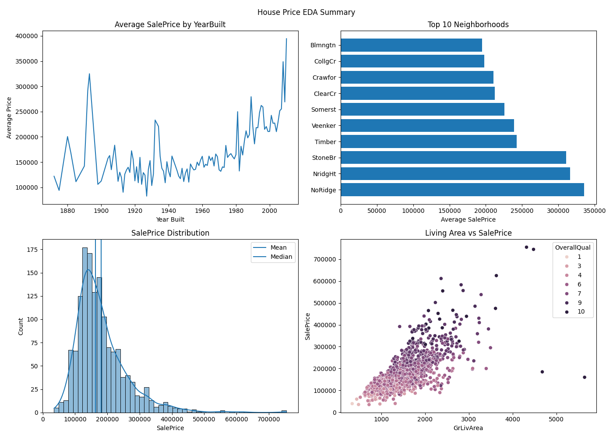

# House Price EDA Project

## Project Overview
This project performs Exploratory Data Analysis (EDA) on the Ames Housing Dataset to understand the factors related to house sale prices.

The project uses Python libraries to explore, clean, visualize, and analyse the dataset.

## Objectives
- Understand the distribution of house sale prices.
- Identify numerical, categorical, and ordinal variables.
- Calculate descriptive statistics.
- Study correlation and covariance.
- Visualize relationships between house features and sale prices.
- Detect and analyse outliers.
- Check missing values and data quality.
- Create a final EDA dashboard.

## Dataset
**Dataset:** Ames Housing Dataset  
**File:** `train.csv`  
**Source:** [Kaggle - House Prices: Advanced Regression Techniques](https://www.kaggle.com/competitions/house-prices-advanced-regression-techniques/data)

Download the dataset from Kaggle and place `train.csv` in the project folder before running the notebook. Please follow the dataset's terms of use.

## Technologies Used
- Python
- Pandas
- NumPy
- Matplotlib
- Seaborn
- SciPy
- Jupyter Notebook / Google Colab

## Project Structure

```text
House-Price-EDA/
│
├── House_Price_EDA.ipynb
├── eda_dashboard.png
├── requirements.txt
└── README.md
```

## Project Workflow
1. Setup and data loading
2. Variable classification
3. Descriptive statistics
4. Distribution analysis
5. Correlation and covariance
6. Scatter plots and pair plots
7. Correlation heatmap
8. Outlier detection
9. Data quality checks
10. Final dashboard and conclusions

## Dashboard



## How to Run
1. Download or clone this repository.
2. Download `train.csv` from the Kaggle dataset page.
3. Keep `train.csv` in the same folder as the notebook.
4. Install the required libraries:

```bash
pip install -r requirements.txt
```

5. Open `House_Price_EDA.ipynb` in Jupyter Notebook or Google Colab.
6. Run the notebook cells in order.

## Project Scope
This project focuses on Exploratory Data Analysis only. It does not include machine learning model training or prediction.

## Conclusion
The project explores house prices through statistical analysis and visualizations. It helps understand relationships between property features and sale prices, along with data quality issues and unusual observations.
